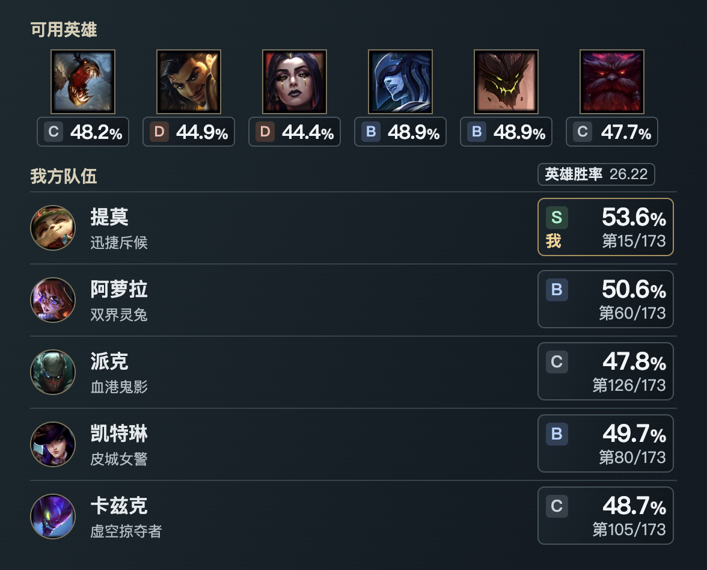
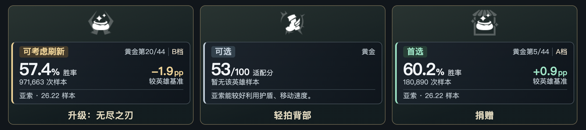
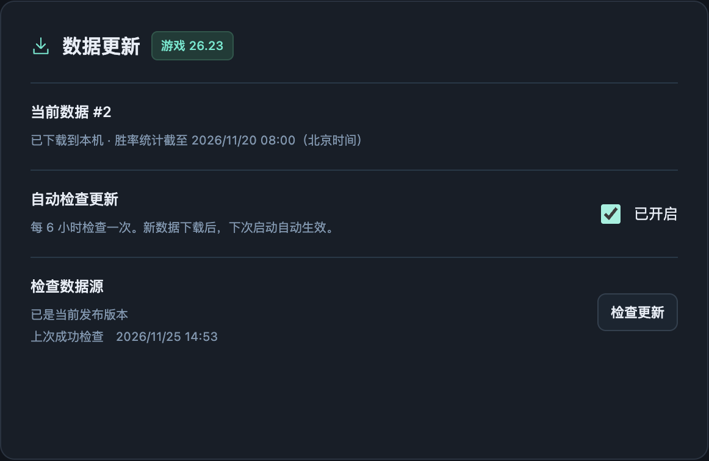

# 海克斯参谋 · Hex Companion

英雄联盟「海克斯大乱斗」的 **Windows 10 / 11 x64 桌面助手**。三选一出现时，助手用本地中文 OCR 识别卡片，在每个候选旁显示该英雄的样本胜率、同阶排名，以及它和本局已选海克斯的搭配理由。关掉选卡面板后，右上角仍可查看下一件推荐装备。


## 从源码启动

在 Windows 上安装 Git 和 Node.js 22.12 或更高版本，在 PowerShell 中运行以下命令。首次安装依赖和启动 Electron 需要联网。简体中文 OCR 模型、攻略和统计快照都已随仓库提供，使用助手无需账号或 API Key。

```powershell
git clone https://github.com/JohnJyong/hex-companion.git
cd hex-companion
npm ci
npm start
```

如果访问 GitHub 依赖已配置的 `HTTPS_PROXY`，可在同一个 PowerShell 窗口运行 `$env:ELECTRON_GET_USE_PROXY = "1"` 后重试。Electron 会通过该代理下载运行时。

## 玩一局

选人和选卡的配图取自桌面助手的离线回放。

1. **选人**　先打开助手，再切回国服中文客户端。出现「可用」英雄栏后，左侧队伍和顶部备选头像会显示对应英雄的模式胜率。这里统计的是英雄在样本对局中的表现，个人账号战绩不参与计算。

   

2. **识别**　进入对局，在助手的「实时识别」中刷新窗口，选择游戏窗口并开启识别，然后切回游戏。建议使用无边框或窗口模式。独占全屏可能截到黑屏，切出或最小化游戏时识别暂停。游戏画面仅在本机内存中处理。

3. **选卡**　等三张卡出现评分后，先按 `Ctrl+Alt+1`、`Ctrl+Alt+2` 或 `Ctrl+Alt+3` 记录左、中、右选项，再在游戏中点选。记录会进入下一轮的联动评分。例如已有「火上浇油」时，遇到「易损」会提示两者的灼烧暴击联动。若已点掉卡片，可在主窗口「已选海克斯」补录或更正。

   

4. **出装**　游戏右上角显示下一件成装、整件价格及后续顺序，主窗口「推荐出装」可查看完整路线。开启装备同步后，已购成装会推进路线。部分客户端只报告普通大乱斗，这时首次认出三张海克斯后才会显示局内出装。

   

| 游戏前台快捷键 | 作用 |
| --- | --- |
| `Ctrl+Alt+1 / 2 / 3` | 稳定识别后记录准备选择的左／中／右卡，实际选择仍由玩家点击 |
| `Ctrl+Alt+H` 或 `F8` | 隐藏或恢复浮层，也可在主窗口操作 |

## 数据怎么更新

**0.7.0 起，游戏资料可以独立更新。** 使用 0.6.x 的玩家需要先更换一次 Windows 客户端。之后打开「设置与数据 → 数据更新」，就能看到当前数据编号、游戏版本、胜率统计截止时间和上次成功检查的时间。

- 助手默认在启动时检查，距离上次成功检查不足 6 小时会跳过。持续运行时也会定期检查。点「检查更新」随时可手动检查。
- 更新在后台下载并校验。正在识别时，本局继续沿用当前版本。下次启动自动启用新数据，也可在停止识别后点「应用新数据」。对局记录保存在本机，更新会保留仍然有效的选择和装备。
- 断网时，助手使用最近一次校验通过的本地数据。首次离线启动使用内置 26.22。关闭自动检查后仍可以手动更新。



项目每天检查两次上游的常规海克斯统计及匹配的客户端资源。有新资料且校验通过时，发布到独立数据分支。项目维护的英雄适配、海克斯联动、出装模板和攻略，在资料修订后进入同一发布流程。局内界面、选人浮层和英雄榜共用已启用的数据版本。[当前数据清单](https://github.com/JohnJyong/hex-companion/blob/data-v1/manifest.json) · [发布任务记录](https://github.com/JohnJyong/hex-companion/actions/workflows/data-channel.yml)

## 推荐依据与统计口径

- **英雄与海克斯**　26.23 数据包含 173 位英雄、242 个海克斯和 114 件装备。卡片上的 `+x.x pp` 是「该英雄持有此海克斯的胜率」减去「该英雄的基准胜率」，单位为百分点。同阶排名只纳入至少 3,000 次出场且通过样本筛选的记录。缺少样本时仍可看机制适配分。
- **装备与组合**　装备建议从该英雄的常见前三件、已购装备和本局海克斯出发。样本胜率只对应标明的原始装备组合。六格路线和多数海克斯联动按机制推导。攻略库内置 22 条中文笔记与 420 条社区搭配索引，保留适用条件和原文链接。
- **统计时间**　首批独立发布的 26.23 数据包含 **4,991,976 局**常规海克斯大乱斗样本，统计截至 **2026-11-20 08:00（北京时间）**。每个补丁有独立的样本窗口，英雄榜可查看当前版本的实际局数。攻略保留各自的核对日期与适用版本。[本次统计来源](https://github.com/czgreat/aramhex-data/tree/data-v20/patches/16.23/normal)

## 开发与 Windows 打包

```powershell
npm run package:win
```

在 `release/HexCompanion-win32-x64/` 中运行 `HexCompanion.exe`。分发时压缩整个目录，玩家解压后即可启动，无需安装 Node.js。当前构建未签名。

| 检查 | 命令 |
| --- | --- |
| 推荐、数据、识别逻辑与对局状态 | `npm test`（需要 Python 3，Windows 命令为 `python`） |
| 工作台与模拟对局流程 | `npm run test:desktop`、`npm run test:live` |
| 离线中文 OCR、选卡及选人浮层 | `npm run test:ocr`、`npm run test:overlay`、`npm run test:select` |
| 从公开数据源升级、保留对局、断网重启 | `npm run test:data:online`（需联网，公开版本须比内置数据新）。可在 [Windows 验证任务](https://github.com/JohnJyong/hex-companion/actions/workflows/windows-data-check.yml)中运行打包后的 EXE。 |
| 验证 Windows 包内资源 | 先运行 `npm run test:ocr` 和 `npm run package:win`，再运行 `node tests/packaged.e2e.mjs` |

`app/core/` 实现评分、出装和候选匹配，`desktop/` 负责 Windows 截屏、OCR、浮层与数据缓存。桌面版使用系统网络获取数据，日常识别和查询在本机完成。

### 维护游戏资料

- 修订英雄适配、海克斯效果与直接联动、装备路线或互斥组，编辑 [recommendation-rules.json](app/data/recommendation-rules.json)。中文攻略和已核对的社区索引保存在 [app/data](app/data/)。这些 JSON 推送到 `main` 后会触发数据发布，已安装的客户端可直接获取。
- 正常统计刷新会核对上游标签、常规模式、补丁及每个文件的 SHA-256。英雄榜、海克斯统计和装备统计使用同一批次。可从 GitHub Actions 手动运行 **Refresh game data**。更新失败时继续提供上一次成功发布的资料。[刷新脚本](scripts/refresh-channel.py)
- 数据包包含 JSON 和 PNG。调整评分算法、OCR 或窗口功能时发布新程序。数据源、使用许可与统计范围见[第三方声明](THIRD_PARTY_NOTICES.md)和[参考项目与统计口径](docs/REFERENCE_REVIEW.md)。

如需在本地复现发布，从源码目录执行以下命令。有新数据时再提交并推送。

```powershell
git clone --branch data-v1 --single-branch https://github.com/JohnJyong/hex-companion.git ../hex-data
python scripts/refresh-channel.py ../hex-data
git -C ../hex-data add -- manifest.json '*.json.gz'
git -C ../hex-data commit -m "Refresh game data"
git -C ../hex-data push origin HEAD:data-v1
```

维护者也可用 `npm run data:pack -- --source <已整理的app目录> --out ../hex-data --revision <下一数据编号>` 发布手工核对的数据。同一编号对应固定内容，发布新清单时保留旧包供下载中的客户端使用。[版本记录](docs/VERSION_NOTES.md)

如遇黑屏、卡片识别错误或装备推荐偏差，反馈时请附上助手版本、游戏分辨率、系统缩放、窗口模式，以及能复现问题的英雄和海克斯组合。[提交问题](https://github.com/JohnJyong/hex-companion/issues)

## 许可与致谢

| 内容 | 来源与许可 |
| --- | --- |
| 海克斯参谋原创代码 | 源码附 [MIT 许可证](https://github.com/JohnJyong/hex-companion/blob/main/LICENSE)，Windows 打包目录附 `LICENSE-HexCompanion.txt`。 |
| 英雄、海克斯与装备统计 | 海克斯大乱斗统计数据（github.com/czgreat/aramhex-data），CC BY-NC 4.0，仅限非商业使用。[数据与许可](https://github.com/czgreat/aramhex-data/blob/main/LICENSE) |
| 社区搭配索引 | [数据来源：arammayhem.com](https://arammayhem.com/data/)（[CC BY 4.0](https://creativecommons.org/licenses/by/4.0/)） |
| 本地 OCR 与简中模型 | Tesseract.js、Tesseract.js-core 和 tessdata_fast（Apache-2.0）。[第三方声明](THIRD_PARTY_NOTICES.md) |
| 游戏资料与图像 | 通过 [Riot Data Dragon](https://developer.riotgames.com/docs/lol#data-dragon) 和 [CommunityDragon](https://communitydragon.org/) 获取，相关权利归原权利人。 |

感谢 [AramHex](https://github.com/czgreat/aramhex) 和 [ARAM-tool](https://github.com/MJ33520/ARAM-tool) 对功能与数据调研的帮助。海克斯参谋是独立社区项目，使用 Riot Games 的游戏素材，未经 Riot Games 或腾讯背书。[Riot Games 素材使用政策](https://www.riotgames.com/en/legal) · [第三方许可与修改说明](THIRD_PARTY_NOTICES.md)
