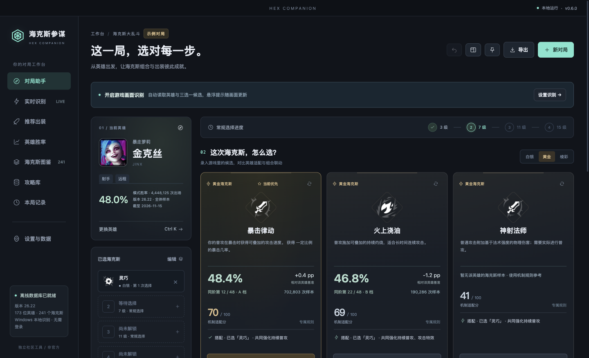
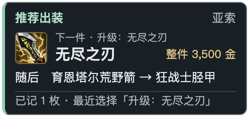

# 海克斯参谋 · Hex Companion

英雄联盟「海克斯大乱斗」的 **Windows 10 / 11 x64 桌面助手**。三选一出现时，助手用本地中文 OCR 识别卡片，在每个候选旁显示该英雄的样本胜率、同阶排名，以及它和本局已选海克斯的搭配理由。关掉选卡面板后，右上角仍可查看下一件推荐装备。



## 从源码启动

在 Windows 上安装 Git 和 Node.js 22.12 或更高版本，在 PowerShell 中运行以下命令。首次安装依赖和启动 Electron 需要联网。简体中文 OCR 模型、攻略和统计快照都已随仓库提供，使用助手无需账号或 API Key。

```powershell
git clone https://github.com/JohnJyong/hex-companion.git
cd hex-companion
npm ci
npm start
```

如果访问 GitHub 依赖已配置的 `HTTPS_PROXY`，可在同一个 PowerShell 窗口运行 `$env:ELECTRON_GET_USE_PROXY = "1"` 后重试。Electron 会通过该代理下载运行时。

## 玩一局

1. **选人**　先打开助手，再切回国服中文客户端。出现「可用」英雄栏后，左侧队伍和顶部备选头像会显示对应英雄的模式胜率。这里统计的是英雄在样本对局中的表现，个人账号战绩不参与计算。
2. **识别**　进入对局，在助手的「实时识别」中刷新窗口，选择游戏窗口并开启识别，然后切回游戏。建议使用无边框或窗口模式。独占全屏可能截到黑屏，切出或最小化游戏时识别暂停。游戏画面仅在本机内存中处理。
3. **选卡**　等三张卡出现评分后，先按 `Ctrl+Alt+1`、`Ctrl+Alt+2` 或 `Ctrl+Alt+3` 记录左、中、右选项，再在游戏中点选。记录会进入下一轮的联动评分。例如已有「火上浇油」时，遇到「易损」会提示两者的灼烧暴击联动。若已点掉卡片，可在主窗口「已选海克斯」补录或更正。
4. **出装**　游戏右上角显示下一件成装、整件价格及后续顺序，主窗口「推荐出装」可查看完整路线。开启装备同步后，已购成装会推进路线。部分客户端只报告普通大乱斗，这时首次认出三张海克斯后才会显示局内出装。



| 游戏前台快捷键 | 作用 |
| --- | --- |
| `Ctrl+Alt+1 / 2 / 3` | 稳定识别后记录准备选择的左／中／右卡，实际选择仍由玩家点击 |
| `Ctrl+Alt+H` 或 `F8` | 隐藏或恢复浮层，也可在主窗口操作 |

## 推荐依据与更新时间

- **英雄与海克斯**　内置 173 位英雄、241 个海克斯和 114 件装备。卡片上的 `+x.x pp` 是「该英雄持有此海克斯的胜率」减去「该英雄的基准胜率」，单位为百分点。同阶排名只纳入至少 3,000 次出场且通过样本筛选的记录。缺少样本时仍可看机制适配分。
- **装备与组合**　装备建议从该英雄的常见前三件、已购装备和本局海克斯出发。样本胜率只对应标明的原始装备组合。六格路线和多数海克斯联动按机制推导。攻略库内置 22 条中文笔记与 420 条社区搭配索引，保留适用条件和原文链接。
- **数据版本**　0.6.0 内置常规海克斯大乱斗（KIWI）**26.22** 版本资料。统计截至 **2026-11-15 17:00（北京时间）**，覆盖国服七个大区的 48,081,485 局样本。对局中的英雄、装备和候选会随游戏变化。胜率随数据版本发布更新，当前客户端使用内置快照。

## 开发与 Windows 打包

```powershell
npm run package:win
```

在 `release/HexCompanion-win32-x64/` 中运行 `HexCompanion.exe`。分发时压缩整个目录，玩家解压后即可启动，无需安装 Node.js。当前构建未签名。

| 检查 | 命令 |
| --- | --- |
| 推荐、数据、识别逻辑与对局状态 | `npm test`（需要 Python 3，Windows 命令为 `python`） |
| 工作台与模拟对局流程 | `npm run test:desktop`、`npm run test:live` |
| 离线中文 OCR 与浮层 | `npm run test:ocr`、`npm run test:overlay` |
| 验证 Windows 包内资源 | 先运行 `npm run test:ocr` 和 `npm run package:win`，再运行 `node tests/packaged.e2e.mjs` |

`app/core/` 包含联动评分、出装和候选匹配逻辑，`desktop/` 负责 Windows 截屏、OCR 进程和浮层，`app/data/` 保存离线资料。维护者可以用 Python 重建静态目录、英雄×海克斯及装备统计，或刷新社区搭配索引。英雄榜快照单独维护。详见[数据脚本](scripts/)、[参考项目与统计口径](docs/REFERENCE_REVIEW.md)和[版本记录](docs/VERSION_NOTES.md)。

如遇黑屏、卡片识别错误或装备推荐偏差，反馈时请附上助手版本、游戏分辨率、系统缩放、窗口模式，以及能复现问题的英雄和海克斯组合。[提交问题](https://github.com/JohnJyong/hex-companion/issues)

## 许可与致谢

| 内容 | 来源与许可 |
| --- | --- |
| 海克斯参谋原创代码 | 源码附 [MIT 许可证](https://github.com/JohnJyong/hex-companion/blob/main/LICENSE)，Windows 打包目录附 `LICENSE-HexCompanion.txt`。 |
| 英雄、海克斯与装备统计 | 海克斯大乱斗统计数据（github.com/czgreat/aramhex-data），CC BY-NC 4.0，仅限非商业使用。[数据与许可](https://github.com/czgreat/aramhex-data/blob/data-v18/LICENSE) |
| 社区搭配索引 | [数据来源：arammayhem.com](https://arammayhem.com/data/)（[CC BY 4.0](https://creativecommons.org/licenses/by/4.0/)） |
| 本地 OCR 与简中模型 | Tesseract.js、Tesseract.js-core 和 tessdata_fast（Apache-2.0）。[第三方声明](THIRD_PARTY_NOTICES.md) |
| 游戏资料与图像 | 通过 [Riot Data Dragon](https://developer.riotgames.com/docs/lol#data-dragon) 和 [CommunityDragon](https://communitydragon.org/) 获取，相关权利归原权利人。 |

感谢 [AramHex](https://github.com/czgreat/aramhex) 和 [ARAM-tool](https://github.com/MJ33520/ARAM-tool) 对功能与数据调研的帮助。海克斯参谋是独立社区项目，使用 Riot Games 的游戏素材，未经 Riot Games 或腾讯背书。[Riot Games 素材使用政策](https://www.riotgames.com/en/legal) · [第三方许可与修改说明](THIRD_PARTY_NOTICES.md)
